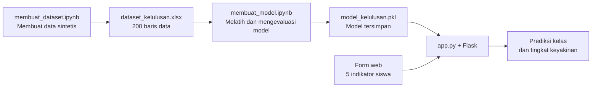

# Prediksi Kelulusan Siswa

Aplikasi web sederhana untuk memperkirakan status kelulusan siswa berdasarkan nilai tugas, UTS, UAS, persentase kehadiran, dan jumlah absen. Proyek ini dibuat sebagai latihan alur kerja machine learning dari pembuatan dataset, pelatihan model klasifikasi, hingga pemakaian model melalui aplikasi Flask.

<p align="center">
  <strong>Bahasa &amp; library yang digunakan</strong><br><br>
  
  
  
  
  
  
  
  
</p>

> **Catatan penting:** Dataset proyek ini dibuat secara sintetis untuk keperluan pembelajaran. Hasil prediksi bukan keputusan akademik dan tidak boleh digunakan sebagai satu-satunya dasar untuk menilai siswa.

## Navigasi

- [Gambaran proyek](#gambaran-proyek)
- [Fitur aplikasi](#fitur-aplikasi)
- [Alur kerja](#alur-kerja)
- [Struktur proyek](#struktur-proyek)
- [Persyaratan](#persyaratan)
- [Menjalankan aplikasi](#menjalankan-aplikasi)
- [Menggunakan aplikasi](#menggunakan-aplikasi)
- [Dataset dan aturan label](#dataset-dan-aturan-label)
- [Pelatihan model](#pelatihan-model)
- [Teknologi](#teknologi)
- [Batasan dan pengembangan](#batasan-dan-pengembangan)

## Gambaran proyek

Aplikasi menerima lima indikator akademik, mengubahnya menjadi data dengan nama kolom yang dibutuhkan model, lalu menampilkan kelas prediksi beserta tingkat keyakinan model untuk kelas tersebut. Model yang sudah dilatih disimpan sebagai `model_kelulusan.pkl` dan dimuat ketika aplikasi dijalankan.

Kelas keluaran model:

| Kelas | Makna |
| --- | --- |
| `Lulus` | Model memperkirakan siswa memenuhi kategori lulus pada dataset latihan. |
| `Tidak Lulus` | Model memperkirakan siswa masuk kategori tidak lulus pada dataset latihan. |

## Fitur aplikasi

- Form input untuk lima indikator akademik.
- Kontrol angka dan slider untuk memudahkan pengisian.
- Preset contoh **Performa tinggi**, **Performa sedang**, dan **Perlu perhatian**.
- Prediksi status kelulusan melalui model Random Forest.
- Tampilan tingkat keyakinan untuk kelas yang diprediksi.
- Antarmuka responsif berbahasa Indonesia.

## Alur kerja



## Struktur proyek

```text
2_proyek_machine_learning_Gramandha_Wega_Intyanto/
├── app.py                  # Aplikasi Flask dan proses prediksi
├── dataset_kelulusan.xlsx  # Dataset sintetis yang digunakan untuk latihan
├── membuat_dataset.ipynb   # Notebook pembuatan dan pemeriksaan dataset
├── membuat_model.ipynb     # Notebook pelatihan dan evaluasi Random Forest
├── model_kelulusan.pkl     # Model klasifikasi yang dimuat aplikasi
├── requirements.txt        # Dependensi untuk menjalankan aplikasi web
├── templates/
│   └── index.html          # Antarmuka form dan hasil prediksi
└── venv/                   # Lingkungan virtual lokal (jika tersedia)
```

> Folder `venv/` merupakan lingkungan Python lokal. Folder tersebut tidak diperlukan jika Anda membuat lingkungan sendiri, dan biasanya tidak perlu dibagikan atau dimasukkan ke repositori.

### Peran berkas utama

<details>
<summary><strong>Lihat penjelasan setiap berkas</strong></summary>

- **`app.py`** — Memuat model, menerima input dari form, menyusun input dalam urutan kolom yang diharapkan, lalu menjalankan `predict()` dan `predict_proba()`.
- **`templates/index.html`** — Menyediakan tampilan aplikasi, validasi dasar di browser, slider, preset input, dan area hasil.
- **`dataset_kelulusan.xlsx`** — Dataset berisi identitas sintetis, lima fitur masukan, dan kolom target `Status_Lulus`.
- **`membuat_dataset.ipynb`** — Menghasilkan data dengan nilai acak yang dapat direproduksi menggunakan random seed `42`, membuat label, dan menyimpan hasil ke Excel.
- **`membuat_model.ipynb`** — Memisahkan fitur dan target, melatih Random Forest, menampilkan metrik evaluasi dan confusion matrix, mencoba beberapa sampel, serta menyimpan model pickle.
- **`model_kelulusan.pkl`** — Artefak model yang dipakai oleh aplikasi web. Artefak ini harus tetap sesuai dengan pustaka dan skema fitur yang digunakan oleh kode.
- **`requirements.txt`** — Daftar paket yang dibutuhkan oleh aplikasi web.

</details>

## Persyaratan

- Python 3.
- `pip`.
- Browser web modern.

Dependensi aplikasi web tercantum di [`requirements.txt`](./requirements.txt): Flask, NumPy, pandas, scikit-learn, dan openpyxl.

## Menjalankan aplikasi

Buka PowerShell pada folder proyek, kemudian jalankan perintah berikut:

```powershell
# Buat lingkungan virtual baru (opsional, tetapi disarankan)
python -m venv .venv

# Aktifkan lingkungan virtual
.\.venv\Scripts\Activate.ps1

# Pasang dependensi aplikasi
python -m pip install -r requirements.txt

# Jalankan aplikasi
python app.py
```

Setelah server berjalan, buka alamat berikut di browser:

**http://127.0.0.1:5000**

Untuk menghentikan server, kembali ke terminal lalu tekan **Ctrl+C**.

> Jika PowerShell menolak aktivasi skrip karena kebijakan eksekusi, Anda dapat menjalankan perintah `python -m pip install -r requirements.txt` dan `python app.py` dari terminal dengan Python yang sama tanpa mengaktifkan lingkungan virtual.

### Catatan menjalankan server

`app.py` menjalankan Flask dengan `debug=True` pada port `5000`, yang sesuai untuk penggunaan lokal saat belajar. Mode debug tidak ditujukan untuk server produksi atau akses publik. Jangan mengekspos server debug ke jaringan yang tidak tepercaya.

## Menggunakan aplikasi

1. Buka halaman aplikasi di `http://127.0.0.1:5000`.
2. Masukkan nilai tugas, nilai UTS, nilai UAS, persentase kehadiran, dan jumlah absen.
3. Isi angka secara langsung atau sesuaikan slider.
4. Jika ingin mencoba cepat, pilih salah satu preset.
5. Tekan **Prediksi kelulusan**.
6. Baca kelas hasil dan tingkat keyakinan model yang ditampilkan.

Input pada form menerima nilai akademik dan persentase pada skala `0–100`, serta jumlah absen `0–30`. Data sintetis yang dipakai saat pelatihan dibuat dengan rentang yang lebih sempit—lihat bagian [Dataset dan aturan label](#dataset-dan-aturan-label). Prediksi untuk input di luar rentang data latihan dapat kurang representatif.

## Dataset dan aturan label

Notebook pembuat dataset menghasilkan **200 baris** menggunakan angka acak dengan seed `42`. Kolom-kolomnya adalah:

| Kolom | Peran | Keterangan |
| --- | --- | --- |
| `Siswa_ID` | Identitas sintetis | ID siswa buatan, misalnya `SISWA_001`. |
| `Nilai_Tugas` | Fitur | Nilai tugas, dibuat pada rentang 50–99. |
| `Nilai_UTS` | Fitur | Nilai UTS, dibuat pada rentang 45–99. |
| `Nilai_UAS` | Fitur | Nilai UAS, dibuat pada rentang 40–99. |
| `Persentase_Kehadiran` | Fitur | Kehadiran, dibuat pada rentang 60–99%. |
| `Jumlah_Absen` | Fitur | Jumlah absen, dibuat pada rentang 0–11. |
| `Status_Lulus` | Target | Label `Lulus` atau `Tidak Lulus`. |

Label target dibentuk menggunakan aturan buatan berikut:

```text
Nilai akhir = (Nilai tugas × 0,2) + (Nilai UTS × 0,3) + (Nilai UAS × 0,5)

Lulus jika:
  Nilai akhir ≥ 65
  DAN kehadiran ≥ 75%
  DAN jumlah absen ≤ 5

Selain itu: Tidak Lulus
```

Aturan ini mendefinisikan label pada **dataset latihan**, bukan kebijakan kelulusan resmi atau aturan yang diterapkan langsung oleh aplikasi pada saat prediksi. Saat aplikasi digunakan, kelas diperkirakan oleh model Random Forest yang belajar dari contoh data tersebut.

## Pelatihan model

Notebook pelatihan menggunakan lima kolom sebagai fitur:

```text
Nilai_Tugas
Nilai_UTS
Nilai_UAS
Persentase_Kehadiran
Jumlah_Absen
```

`Status_Lulus` menjadi target klasifikasi. Data dibagi menjadi data latih dan data uji dengan rasio **80:20**, `random_state=42`, dan `stratify=y`. Model yang digunakan adalah `RandomForestClassifier` dengan `n_estimators=100` dan `random_state=42`.

Notebook menampilkan akurasi, classification report, dan confusion matrix pada data uji. README ini tidak menetapkan angka akurasi tertentu; jalankan notebook untuk melihat hasil evaluasi dari dataset dan versi pustaka yang digunakan.

### Menjalankan notebook

Notebook dibuat dengan alur unggah/unduh berkas Google Colab (`google.colab.files`). Untuk menjalankannya dengan alur yang tersedia:

1. Buka notebook di Google Colab.
2. Jalankan `membuat_dataset.ipynb` dari atas ke bawah untuk menghasilkan dan mengunduh `dataset_kelulusan.xlsx`.
3. Buka `membuat_model.ipynb`, lalu unggah dataset ketika diminta.
4. Jalankan sel notebook secara berurutan untuk melatih, mengevaluasi, dan mengunduh `model_kelulusan.pkl`.
5. Simpan berkas hasil di folder proyek jika ingin menggunakannya melalui aplikasi Flask.

> Notebook model juga memakai Matplotlib dan Seaborn untuk visualisasi. Lingkungan Google Colab umumnya menyediakan dependensi notebook tersebut; daftar di `requirements.txt` ditujukan untuk menjalankan aplikasi web.

## Teknologi

- **Python** — bahasa pemrograman.
- **Flask** — server web dan pemrosesan form.
- **pandas** dan **NumPy** — pengolahan data dan input prediksi.
- **scikit-learn** — pelatihan, evaluasi, dan inferensi model.
- **Jupyter Notebook / Google Colab** — eksperimen dan dokumentasi alur machine learning.
- **HTML dan CSS** — antarmuka web.
- **Excel (`.xlsx`)** — format penyimpanan dataset.
- **pickle (`.pkl`)** — format penyimpanan model Python.

## Batasan dan pengembangan

- Dataset dibuat dari angka acak dan aturan label sederhana; dataset ini tidak mewakili data siswa nyata.
- Model mempelajari label sintetis tersebut. Hasilnya tidak membuktikan kemampuan generalisasi pada sekolah, kurikulum, atau angkatan lain.
- Tingkat keyakinan yang ditampilkan adalah probabilitas kelas keluaran dari model, bukan jaminan bahwa prediksi benar.
- Model pickle hanya boleh dimuat dari sumber yang tepercaya. Berkas pickle yang tidak tepercaya dapat menjalankan kode saat dibuka.
- Perubahan pada urutan atau nama fitur perlu diterapkan secara konsisten pada notebook pelatihan dan aplikasi.
- Sebelum penggunaan nyata, diperlukan data yang representatif, evaluasi yang lebih menyeluruh, tinjauan privasi dan bias, serta validasi bersama pihak akademik.

---

<p align="center">
  Dibuat sebagai proyek pembelajaran machine learning — gunakan hasilnya dengan bijak dan tetap tinjau kondisi siswa secara menyeluruh.
</p>
